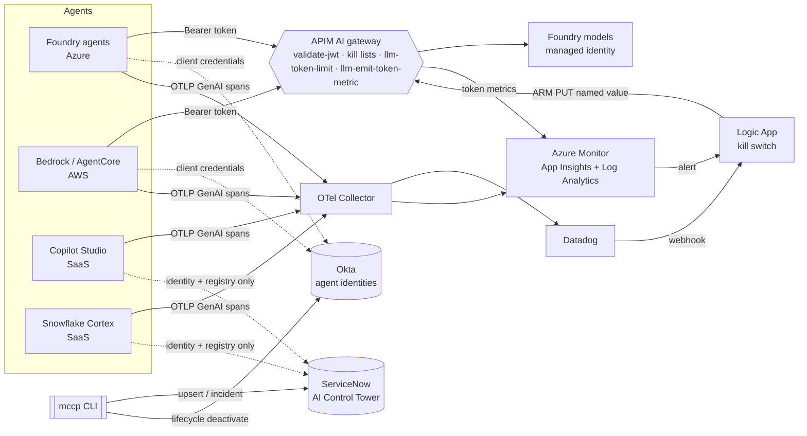
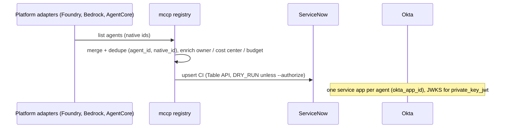
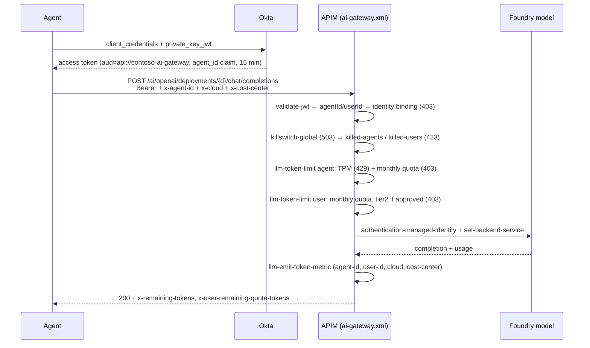
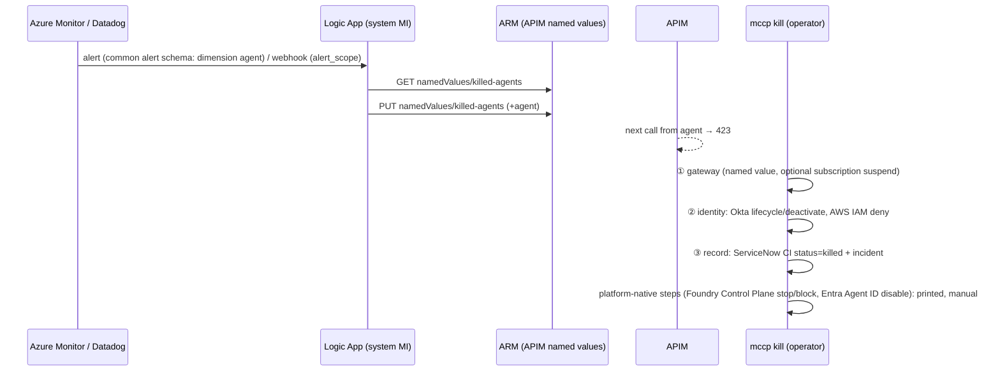

# mccp architecture

## Planes

| Plane | Responsibility | Product (Contoso Health demo) | Enforcement? |
|---|---|---|---|
| **Record** | Inventory, ownership, cost center, lifecycle state, incidents | ServiceNow AI Control Tower (system of record); Foundry Control Plane (Microsoft-side view) | No: it records |
| **Identity** | Who the agent is and whether it can get a token | Okta (service app per agent, private_key_jwt); Entra Agent ID for Foundry / Copilot Studio agents | Yes: no new tokens after deactivate |
| **Runtime** | Every model call: authenticate, attribute, meter, limit, stop | Azure API Management AI gateway (`ai-gateway.xml`) | Yes: works in seconds |
| **Observability** | Traces, token metrics, cost signals | OpenTelemetry GenAI → OTel Collector → Datadog + Azure Monitor | No: it alerts |
| **FinOps** | Spend per agent / user / cost center, forecast, approvals | `finops.py` + Log Analytics + Consumption budget | Through the gateway quotas |
| **Automation** | Alert → action | Azure Monitor alert / Datadog webhook → Logic App → APIM named value | Yes: kill without a human |

**Design rule:** Datadog and Azure Monitor alert, and the gateway enforces. The gateway is the one point every gateway-routed agent passes through, whatever cloud it runs in.

SaaS agents (Copilot Studio, Snowflake Cortex) call their own platform's models, so their traffic does **not** pass through APIM. For these agents, the controls are identity (Okta / Entra), the registry, and platform-native admin actions. The demo marks them `gateway = no`.

## Flow 1: register

## Flow 2: runtime call

## Flow 3: budget breach → kill

The order is gateway first, identity second, record third. The gateway takes effect in seconds; VALIDATE how long a named-value change takes to reach the gateway. Okta deactivation stops **new** tokens, but tokens already issued stay valid until they expire because APIM validates them locally. Keep agent token lifetimes short.

## Flow 4: revive

`mccp revive --agent X --authorize` reverses the same points: it removes X from `killed-agents`, sets the subscription to `active`, calls Okta `lifecycle/activate`, deletes the AWS deny policy, sets the ServiceNow CI to `active`, and prints the platform steps in reverse.

## Cost limits: dollars to tokens

* Each human user has a **$40/month** standard limit (`data/mccp/budgets.json`).
* `finops.PriceTable.usd_to_tokens` converts that limit to a gateway quota at the reference blended price (gpt-4.1, 70/30 input/output, ILLUSTRATIVE): $40 is about **10.5M tokens**.
* When an approver accepts a request for more, the user is added to `quota-tier2-users`, which uses a separate counter with a $80-equivalent quota.
* The token quota is model-agnostic. It is a hard backstop. `finops.py` computes the exact dollars per model and raises warn/breach and the recommended action.

## Simulator fidelity

`policy_sim.py` runs the same steps in the same order as `ai-gateway.xml`. `XML_ELEMENT_MAP` maps each step to its XML element, and `python -m mccp policy-map` and the tests check that mapping. The simulator also models the APIM subscription state check, which runs **before** any policy. That is why a `--hard` kill returns 401 rather than the clearer 423.
