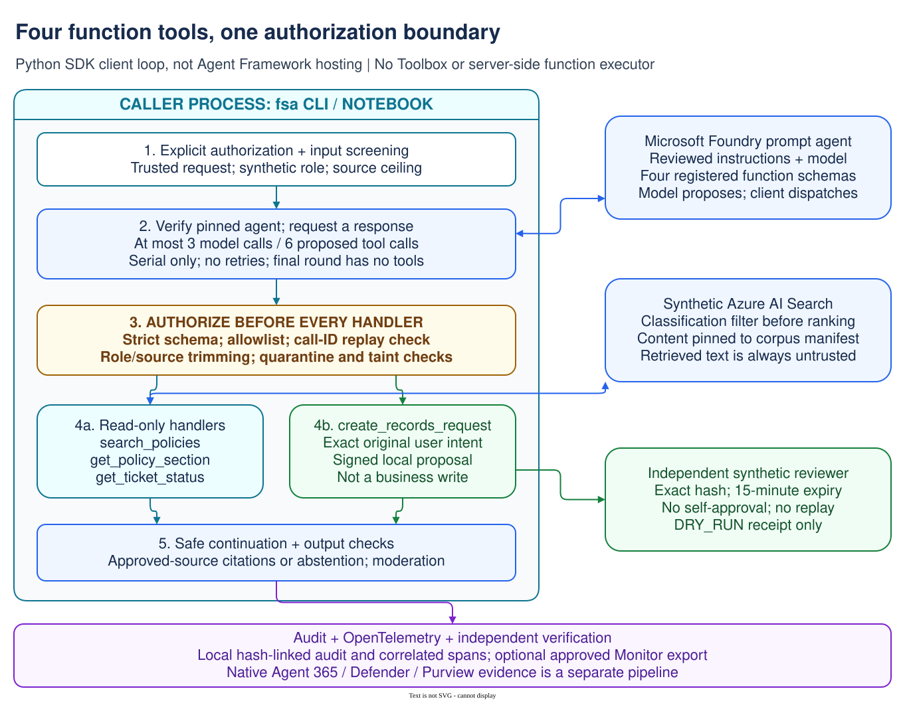
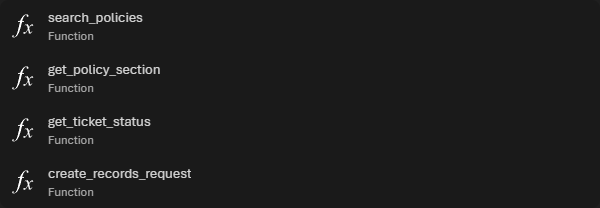

# Architecture: Protect / Prove / Operate

Azure governs infrastructure; Foundry governs the AI workload; Agent 365 governs
the deployed agent. Entra authenticates and authorizes identities. Defender owns
threat investigation; Purview owns data/compliance policy. Azure Monitor owns app
telemetry. These are separate enforcement and evidence surfaces.

## Editable reference diagrams

### Slide-inspired six-plane reference



[Edit in Draw.io](../assets/architecture/six-plane-reference.drawio).
[Open the interactive animation](../assets/architecture/six-plane-reference.html)
locally in a browser: pause/play, step through the flow, or click/focus a card to
inspect its responsibility and evidence boundary. The SVG preview animates
without JavaScript; both versions respect reduced-motion preferences.
GitHub renders SVG images but does not execute the linked HTML; download/open it
locally, or serve the repository with a local-only static server.

Open the source with diagrams.net **File > Open from > Device** or a Draw.io
editor extension. The three-column layout follows the presentation: Entra,
Agent 365 and Purview on the left; the central AI flow; Defender, Monitor and
GitHub on the right. These six surrounding control planes are identity,
governance, data/compliance, threat protection, observability and release
assurance. Foundry is the central AI workflow, not a seventh surrounding plane.

The numbered steps put the caller runtime before the remote Foundry request,
matching this implementation rather than implying Agent Framework hosting.
Both editable diagrams use white backgrounds, pastel groups and large dark
labels. Open the SVG directly for a full-size preview.
The six-plane Draw.io file is also the source of truth for both previews:

```bash
uv run python scripts/render_reference_architecture.py
# Check that committed previews match the editable source, without rewriting:
uv run python scripts/render_reference_architecture.py --check
```

Animation is an educational illustration, not observed traffic, a live portal,
or a working connector. It never acquires credentials, queries Azure or changes
governance settings. It is an interactive HTML/SVG experience, not a GIF file.

Solid arrows describe application/service paths, not independent proof of
successful ingestion. Purple dashed arrows describe native governance
relationships that require their own licensing, publication, configuration and
evidence. Gold dashed arrows are repository validation, not cloud deployment.

The Python SDK runtime and approval queue are in the caller's process, outside
the depicted Azure service boundary. The repository does not implement Agent
Framework hosting, an enterprise approval service, or a business-write connector.
Ordinary Azure AI Search is not a Foundry IQ validation claim.

### Implemented four-function request flow



[Edit in Draw.io](../assets/architecture/governed-function-flow.drawio).
Function definitions are attached directly to the reviewed prompt agent.
The application authorizes and executes handlers; the model cannot directly
execute them, and a Toolbox is not required. The reviewer shown is an explicitly
synthetic exercise, never an authenticated Entra OBO approval.

### Product UI example



This real Foundry UI crop shows function registrations, not remote execution.
The client application supplies authorization and handler execution. The portal
playground does not replace that client or provide independent approval.


This real portal crop illustrates the synthetic agent inventory surface only.
Browser chrome, identities, resource IDs, and unrelated inventory are omitted;
no values or service results are fabricated. Inventory alone proves neither
runtime activity ingestion nor detection, protection, or Purview enforcement.
Keep tenant-specific checks and raw portal captures private.

## Per-module Azure and fallback matrix

| Module | Azure execution | Explicit local fallback |
|---|---|---|
| `config.py` | Validates tenant, subscription, cloud-specific endpoints, pinned agent, Search | Local settings; remote telemetry forbidden |
| `agent.py` | Projects 2.11.0, Entra credential, pinned no-tools prompt agent, Responses API | `LocalAgent`, deterministic synthetic response |
| `presentation_live.py` | Separate reviewed four-function-tool agent; serial bounded Responses loop; policy checks before every client-side handler | `presentation_runtime.py` supplies separately labeled deterministic fixture scenarios |
| `presentation_data.py` | Dedicated content-pinned synthetic Search index; clearance filter before ranking and row validation afterwards | Original fictional corpus; no shared/customer index |
| `presentation_setup.py` | Explicitly authorized create-only index/agent setup; refuses existing names and verifies persisted data/definition | Offline schema/corpus review only |
| `retrieval.py` | SearchClient 12.1.0, query-time entitlement equality filter, bounded results, source schema validation | `LocalRetriever`, same entitlement contract over original synthetic fixtures |
| `security.py` | Same deterministic checks plus optional ContentSafetyClient 1.0.0 input/output moderation | `LocalInspector`, injection-signature and egress/delegation controls |
| `tools.py` | Same closed read-only tool registry; actual retrieval happens through its explicit adapter | Identical policy lookup; never exposes writer |
| `policy.py` | Same authoritative deterministic amount/approval rule | Identical engine, no dependency on model availability |
| `approvals.py` | Exact approval contract and independent approver interface; production authenticated approver NOT_IMPLEMENTED | Explicit synthetic reviewer, local-only |
| `writer.py` | DRY_RUN-only SQLite receipt sink, even in Azure mode | Same idempotent sink; no real business connector |
| `audit.py` | Hash-linked local evidence; external immutable anchoring NOT_IMPLEMENTED | Same chain and independently retainable head |
| `evaluation.py` | Microsoft Foundry relevance/groundedness model judging with `azure-ai-evaluation`; project result tracking, exact row/case reconciliation; shared security gate | Explicit pytest-driven deterministic regressions; no service-equivalence claim |
| `observability.py` | Azure Monitor/Application Insights OTel exporter, read-only Log Analytics query, per-span correlation and delivery evidence | OpenTelemetry SDK JSON without network; optional standard OTLP/HTTP collector when explicitly configured outside local mode |
| `identity.py` | SDK token acquisition bound to configured tenant and tenant-scope guard; no tokens logged | No credential acquisition; synthetic identity in fixtures only |
| `workflow.py` | Routes explicit Azure providers; errors propagate; consequential proposal remains pending approval | Deterministic provider selection, synthetic approval optional |
| `agent365/` | Read-only account fields behind preview REST opt-in; structured operator observations | UNKNOWN/manual checklist, never fake registry or ingestion |
| `azure_ops.py` | Read-only account check and explicit gaps; scoped provisioning guidance | Plans/refusals only, no Azure mutation |
| `contracts.py` | Shared immutable typed service/evidence boundaries | Identical validation |
| `scenarios.py` | Shared regression expectations for normalized service evidence | Synthetic fixtures clearly labeled |
| `cli.py` | Explicit `--mode azure`; no cloud-to-local downgrade | Default `--mode local` |

“Azure and fallback” means an actual service adapter where a supported service
exists, and identical native deterministic enforcement where it does not.
There is deliberately no pretend Azure approval, policy or writer API.

## Data flow

Trusted caller -> entitlement-trimmed retrieval -> untrusted-content check ->
bounded read-only tool -> no-tools model -> output check -> deterministic policy ->
exact independent approval -> DRY_RUN receipt -> audit and trace completeness.

The equipment flow above remains unchanged. The separate Azure presentation flow is:

explicit authorization -> input/source/role screening -> pinned model proposes a
function call -> typed arguments and deterministic authorization -> filtered
synthetic Azure Search or an exact local approval proposal -> safe, untrusted
tool output -> bounded model continuation -> citation/moderation checks -> audit
and traces. The final model round cannot request more tools. Unknown functions,
parallel proposals, call-ID replay, unreviewed definitions and budget exhaustion
fail closed. No Toolbox or server-side remote executor is involved.

The Azure presentation profile uses live model/Search/moderation services but
synthetic application role labels and a local independent-approval exercise.
It is not authenticated Entra OBO, an enterprise approval service, or native
Agent 365/Defender/Purview validation. Use explicit Azure audit/trace commands to
inspect saved live runs; local fixture traces are never substituted for them.

The Azure CLI still requires an authorized selected cloud/subscription. A valid
credential alone does not establish product licensing, region support, effective
RBAC, quota, network access or signal ingestion.
